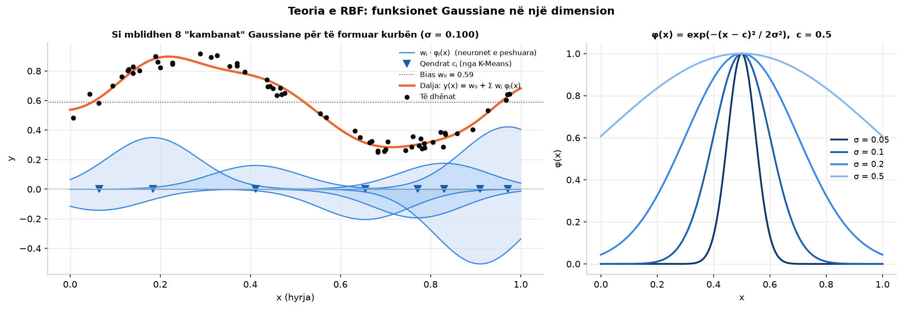
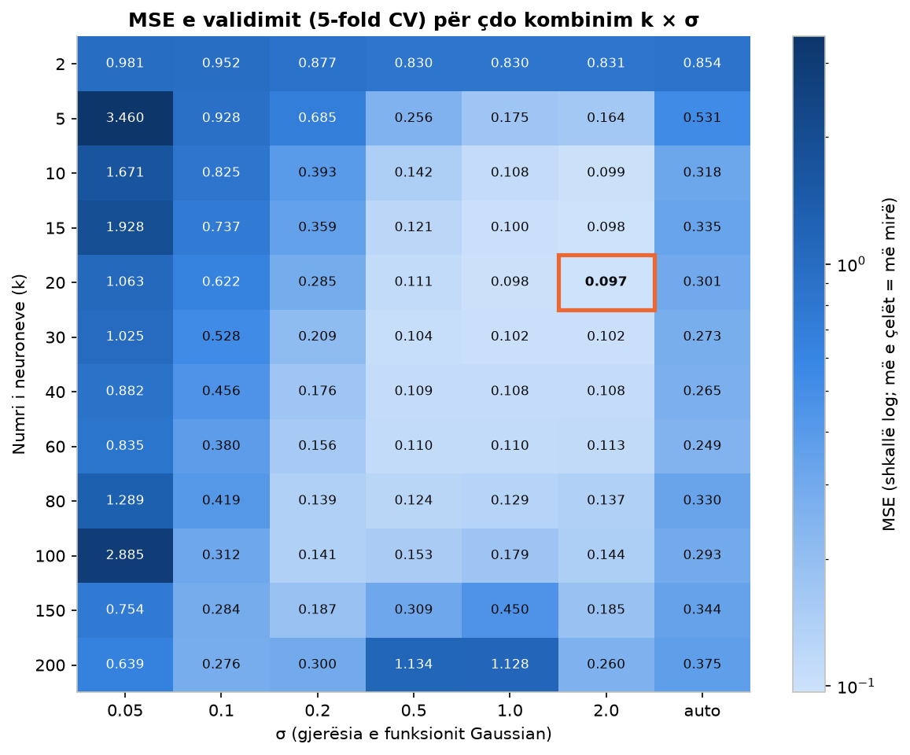
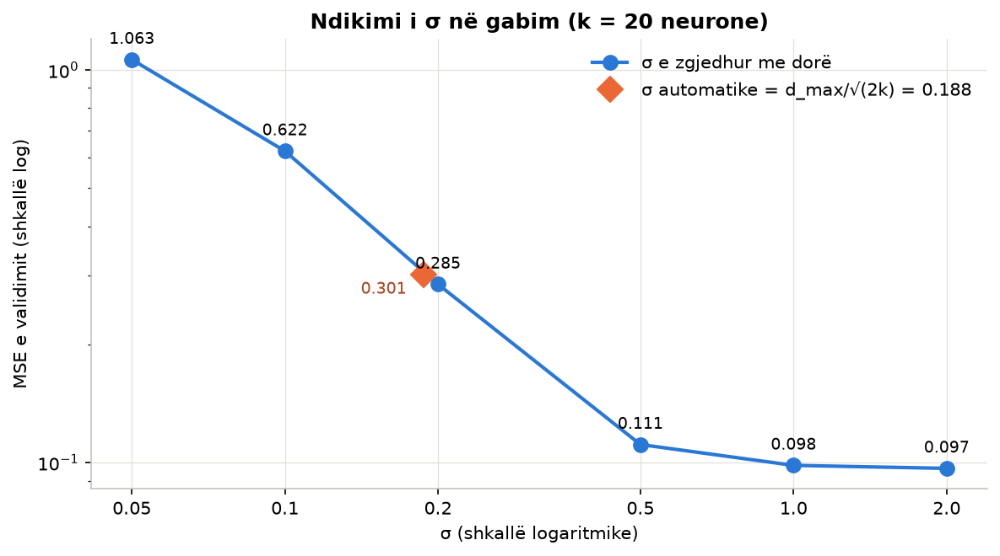
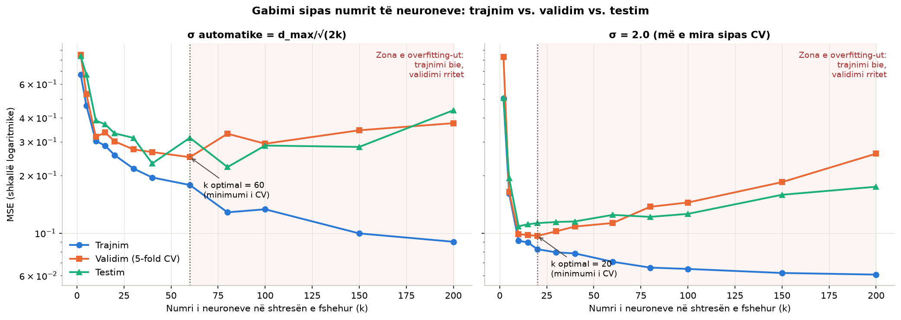
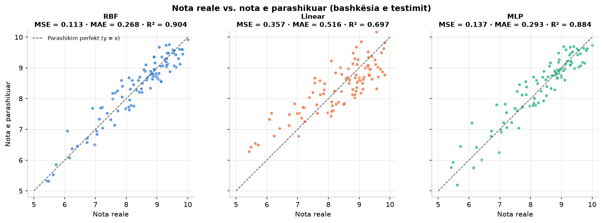
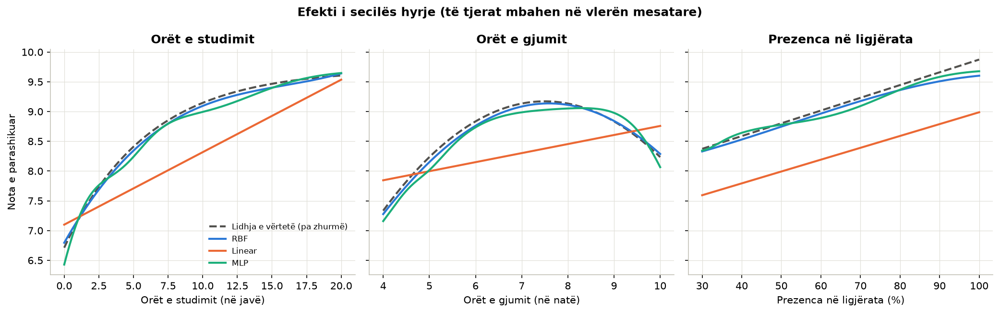
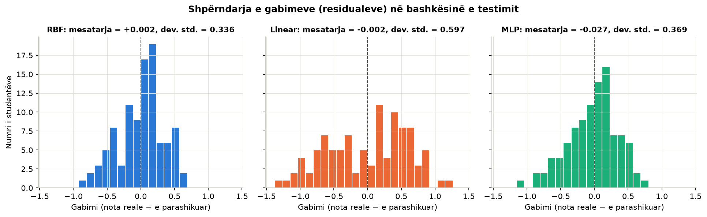

# Parashikimi i notës së studentit me rrjetë RBF (Radial Basis Function)

**Lënda:** Bazat e Inteligjencës Artificiale
**Lloji i punës:** Projekt semestral
**Data:** Nëntor 2026

---

## Përmbledhje

Ky projekt ndërton dhe analizon një rrjetë neurale me funksione bazë radiale (RBF)
për të parashikuar notën përfundimtare të studentit (shkalla 5–10) nga tre hyrje:
orët e studimit në javë, orët e gjumit në natë dhe prezenca në ligjërata. Rrjeta
është implementuar nga e para me NumPy: qendrat gjenden me K-Means, gjerësia σ
caktohet me formulë ose me cross-validation, dhe peshat e daljes llogariten me
pseudo-inverse. Me 5-fold cross-validation u zgjodhën 20 neurone dhe σ = 2.0.
Modeli përfundimtar arriti në bashkësinë e testimit MSE = 0.1128, MAE = 0.2684
dhe R² = 0.9042. Ky rezultat është praktikisht i barabartë me kufirin teorik të
dataset-it (R² = 0.9059) dhe është më i mirë se regresioni linear (R² = 0.6968)
dhe se një MLP referencë (R² = 0.8840). Eksperimentet tregojnë gjithashtu se
formula klasike σ = d_max/√(2k) jep kambana shumë të ngushta për këtë problem,
dhe se numri i tepërt i neuroneve çon në overfitting.

---

## 1. Hyrje dhe qëllimi i projektit

Parashikimi i suksesit akademik është një problem klasik **regresioni**: nga disa
karakteristika të matshme të studentit duam të vlerësojmë një vlerë numerike, notën.
Lidhja midis këtyre faktorëve dhe notës zakonisht **nuk është lineare**:

- Orët e para të studimit ndihmojnë shumë, ndërsa pas një pike çdo orë shtesë jep
  gjithnjë e më pak (efekti i *ngopjes*).
- Gjumi ka një vlerë optimale: si gjumi i pakët, ashtu edhe ai i tepërt e ulin
  rezultatin (formë *U e përmbysur*).
- Prezenca ndihmon pothuajse në mënyrë proporcionale.

Një model linear mund ta përfaqësojë secilin faktor vetëm me një vijë të drejtë, ndaj
nuk i kap dot këto forma. Rrjetat RBF janë të përshtatshme për këtë problem, sepse
mund të përafrojnë çdo funksion të vazhdueshëm si shumë "kambanash" Gaussiane
(Park & Sandberg, 1991) dhe trajnohen shumë shpejt.

**Qëllimet e projektit:**

1. Të implementohet nga e para një rrjetë RBF (K-Means, funksionet Gaussiane,
   pseudo-inverse) për të treguar kuptimin e teorisë.
2. Të studiohet ndikimi i dy hiper-parametrave kryesorë, numrit të neuroneve *k*
   dhe gjerësisë *σ*, dhe të zgjidhen me 5-fold cross-validation.
3. Të krahasohet RBF me regresionin linear dhe me një perceptron shumështresor (MLP).
4. Të ndërtohet një ndërfaqe e thjeshtë që parashikon notën nga vlerat e futura.

---

## 2. Teoria e rrjetave RBF

### 2.1 Arkitektura me tre shtresa

Rrjeta RBF (Broomhead & Lowe, 1988) ka gjithmonë tre shtresa:

| Shtresa | Çfarë bën | Në projektin tonë |
|---|---|---|
| **Hyrëse** | Kalon vektorin e hyrjes pa e ndryshuar | $x = (x_1, x_2, x_3)$: studimi, gjumi, prezenca |
| **E fshehur** | *k* neurone, secili me funksion Gaussian rreth një qendre $c_j$ | *k* = 20 neurone |
| **Dalëse** | Kombinim linear i daljeve të shtresës së fshehur | 1 neuron: nota |

```
   x₁ (studimi)  ──┐      ┌── φ₁(x) ──┐ w₁
   x₂ (gjumi)    ──┼──────┼── φ₂(x) ──┼── w₂ ──►  Σ  ──►  ŷ (nota)
   x₃ (prezenca) ──┘      │    ...    │                ▲
                          └── φₖ(x) ──┘ wₖ           w₀ (bias)
```

Ndryshe nga MLP, lidhjet nga hyrja te shtresa e fshehur **nuk kanë pesha**. Çdo
neuron i fshehur mat vetëm *sa larg* është hyrja nga qendra e tij.

### 2.2 Funksioni Gaussian

Dalja e neuronit të fshehur $j$ është:

$$
\varphi_j(x) = \exp\left( -\frac{\lVert x - c_j \rVert^2}{2\sigma^2} \right)
$$

ku:
- $c_j$ është **qendra** e neuronit (një pikë në hapësirën e hyrjeve),
- $\lVert x - c_j \rVert$ është distanca Euklidiane midis hyrjes dhe qendrës,
- $\sigma$ është **gjerësia** (rrezja e ndikimit) e funksionit.

Vetitë kryesore:
- $\varphi_j(x) = 1$ kur $x = c_j$: hyrja përputhet plotësisht me qendrën.
- $\varphi_j(x) \to 0$ kur hyrja largohet nga qendra.
- Funksioni është **radial**: vlera varet vetëm nga distanca, jo nga drejtimi.

Dalja e rrjetës është:

$$
\hat{y}(x) = w_0 + \sum_{j=1}^{k} w_j \, \varphi_j(x)
$$

Pra, nota e parashikuar del si **shumë e peshuar kambanash**. Çdo kambanë "ngre"
ose "ul" parashikimin në zonën rreth qendrës së saj. Figura 6 e tregon këtë në një
dimension: 8 kambana të peshuara, disa pozitive dhe disa negative, mblidhen me
bias-in $w_0$ dhe formojnë një kurbë të lëmuar që ndjek të dhënat.


*Figura 6. Majtas: si mblidhen kambanat e peshuara $w_j\varphi_j(x)$ për të formuar
daljen e rrjetës (vija portokalli). Djathtas: e njëjta kambanë me σ të ndryshme.*

### 2.3 Roli i qendrave dhe i σ

- **Qendrat** përcaktojnë *ku* vepron secili neuron. Ato duhet të mbulojnë zonat e
  hapësirës ku ka të dhëna. Për këtë arsye i gjejmë me K-Means mbi të dhënat e trajnimit.
- **σ** përcakton *sa larg* vepron secili neuron (paneli i djathtë i Figurës 6):
  - σ **shumë e vogël**: kambanat janë të ngushta dhe nuk mbivendosen. Në hapësirën
    midis qendrave rrjeta jep pothuajse vetëm $w_0$, dhe modeli "mëson përmendësh"
    pikat pa përgjithësuar.
  - σ **shumë e madhe**: të gjitha kambanat bëhen pothuajse të sheshta dhe të
    ngjashme. Modeli lëmohet tepër, dhe zgjidhja numerike e peshave bëhet e
    paqëndrueshme (shih Seksionin 6.3).
  - Vlera e mirë është diku në mes dhe varet nga dendësia e të dhënave.

### 2.4 Krahasimi me MLP

| Aspekti | Rrjeta RBF | MLP (perceptron shumështresor) |
|---|---|---|
| Neuroni i fshehur | Gaussian i distancës: $\exp(-\lVert x-c\rVert^2/2\sigma^2)$ | Funksion i prodhimit skalar: $\tanh(w^\top x + b)$ |
| Natyra | **Lokale**: reagon vetëm afër qendrës | **Globale**: ndikon në gjysmë-hapësira të tëra |
| Trajnimi | Dy faza: qendrat (K-Means), pastaj peshat (sistem linear) | Të gjitha peshat njëkohësisht (backpropagation) |
| Shpejtësia | Shumë e shpejtë: peshat dalin në një hap | Iterative: mijëra hapa optimizimi |
| Minimumet lokale | Jo për peshat e daljes (problem konveks) | Po, varet nga inicializimi |
| Interpretimi | Çdo neuron = "student tipik" | Neuronet janë më të vështirë për t'u interpretuar |
| Dobësia | Kërkon shumë neurone kur ka shumë hyrje (mallkimi i dimensionalitetit) | Shkallëzohet më mirë në dimensione të larta |

Të dyja rrjetat janë **përafrues universalë**: me mjaftueshëm neurone mund të
përafrojnë çdo funksion të vazhdueshëm (Park & Sandberg, 1991; Haykin, 2009).

---

## 3. Dataset-i dhe përgatitja e të dhënave

### 3.1 Gjenerimi

Meqë nuk kishim të dhëna reale, ndërtuam një dataset **sintetik** me 500 studentë.
Hyrjet u gjeneruan me shpërndarje uniforme në intervalet e mëposhtme, dhe nota u
llogarit me një formulë jo-lineare që e njohim plus zhurmë Gaussiane:

$$
\text{nota} = 5 + \underbrace{3\left(1 - e^{-\text{studimi}/6}\right)}_{\text{ngopje}}
+ \underbrace{1 - 0.15(\text{gjumi} - 7.5)^2}_{\text{U e përmbysur}}
+ \underbrace{1.5\,\frac{\text{prezenca} - 30}{70}}_{\text{linear}}
+ \varepsilon, \qquad \varepsilon \sim \mathcal{N}(0,\ 0.3^2)
$$

dhe në fund nota u kufizua në intervalin [5, 10]. Zhurma $\varepsilon$ përfaqëson
faktorët që nuk i matim (talenti, stresi në provim, fati etj.).

Avantazhi i një dataset-i sintetik është se e njohim **lidhjen e vërtetë**. Kështu
mund të kontrollojmë nëse rrjeta e ka "zbuluar" atë (Figura 5) dhe të llogarisim
**kufirin teorik** të saktësisë: edhe formula e vërtetë gabon për shkak të zhurmës.

### 3.2 Statistikat përshkruese

| Variabla | Mesatarja | Dev. standarde | Min | Maks |
|---|---|---|---|---|
| Orët e studimit (në javë) | 9.91 | 5.74 | 0.11 | 19.98 |
| Orët e gjumit (në natë) | 6.99 | 1.78 | 4.01 | 9.99 |
| Prezenca (%) | 65.32 | 20.41 | 30.00 | 100.00 |
| **Nota** | **8.31** | **1.01** | **5.29** | **10.00** |

Korrelacioni (Pearson) i secilës hyrje me notën: studimi **0.673**, prezenca **0.375**,
gjumi **0.221**. Korrelacioni i ulët i gjumit nuk do të thotë që gjumi nuk ndikon.
Ndikimi i tij është jo-linear: gjumi i pakët dhe ai i tepërt ulin notën, dhe këto dy
efekte pjesërisht e anulojnë njëri-tjetrin në një koeficient linear. Hyrjet janë
praktikisht të pavarura nga njëra-tjetra (korrelacione midis tyre nën 0.07 në vlerë absolute).

### 3.3 Përgatitja

1. **Ndarja train/test:** 400 studentë (80%) për trajnim dhe 100 (20%) për testim,
   me përzierje të rastësishme me seed fiks. Bashkësia e testimit **nuk përdoret
   kurrë** për zgjedhjen e parametrave. Përdoret vetëm për vlerësimin përfundimtar.
2. **Normalizimi min-max:** çdo hyrje shndërrohet në intervalin [0, 1]:
   $x' = (x - x_{min}) / (x_{max} - x_{min})$. Ky hap është thelbësor për RBF, sepse
   rrjeta mbështetet te distanca Euklidiane. Pa normalizim, prezenca (diapazon 70)
   do të dominonte gjumin (diapazon 6). Minimumi dhe maksimumi llogariten **vetëm
   nga të dhënat e trajnimit**, që të mos "rrjedhë" informacion nga testi.

---

## 4. Metodologjia

### 4.1 Faza 1a: qendrat me K-Means

Algoritmi K-Means (Lloyd, 1982), i implementuar te `src/kmeans.py`:

1. Zgjidh rastësisht *k* pika trajnimi si qendra fillestare.
2. Cakto çdo pikë te qendra më e afërt (distanca Euklidiane).
3. Rillogarit çdo qendër si mesatare e pikave të grupit të saj.
4. Përsërit hapat 2–3 derisa qendrat të mos lëvizin më (ose deri në 100 iterime).

Nëse një grup mbetet bosh, qendra e tij zhvendoset te një pikë e rastësishme.
Rezultati janë *k* "studentë tipikë" që mbulojnë hapësirën e hyrjeve.

### 4.2 Faza 1b: llogaritja e σ

Provuam dy mënyra:

- **Formula automatike** (Haykin, 2009): $\sigma = \dfrac{d_{max}}{\sqrt{2k}}$, ku
  $d_{max}$ është distanca më e madhe midis dy qendrave. Ideja është që kambanat
  të ngushtohen kur shtohen neurone, që mbulimi i hapësirës të mbetet i balancuar.
- **Vlera fikse** $\sigma \in \{0.05,\ 0.1,\ 0.2,\ 0.5,\ 1.0,\ 2.0\}$ (në hapësirën e
  normalizuar [0,1]³), e zgjedhur me cross-validation.

### 4.3 Faza 2: peshat me pseudo-inverse

Pasi qendrat dhe σ janë fiksuar, rrjeta bëhet **lineare në pesha**. Ndërtojmë
matricën e aktivizimeve $\Phi$ me përmasa $n \times (k+1)$:

$$
\Phi = \begin{bmatrix}
1 & \varphi_1(x_1) & \cdots & \varphi_k(x_1) \\
\vdots & \vdots & \ddots & \vdots \\
1 & \varphi_1(x_n) & \cdots & \varphi_k(x_n)
\end{bmatrix}
$$

Kolona e parë me njësha i përket bias-it $w_0$. Duam $\Phi W \approx y$. Zgjidhja
e katrorëve më të vegjël (që minimizon $\lVert \Phi W - y \rVert^2$) është:

$$
W = \Phi^{+} y = (\Phi^\top \Phi)^{-1} \Phi^\top y
$$

ku $\Phi^{+}$ është **pseudo-inversja Moore–Penrose**. Në kod përdorim
`np.linalg.pinv`, e cila e llogarit atë me dekompozimin SVD dhe funksionon edhe kur
$\Phi^\top\Phi$ nuk është e invertueshme. Kjo është arsyeja pse RBF trajnohet në një
hap të vetëm, pa iterime dhe pa normë mësimi.

### 4.4 Cross-validation me 5 palosje (implementuar vetë)

Për të zgjedhur *k* dhe σ pa prekur bashkësinë e testimit:

1. 400 studentët e trajnimit përzihen dhe ndahen në 5 grupe me nga 80 studentë.
2. Për çdo grup *i* = 1…5: trajnohet rrjeta me 4 grupet e tjera (320 studentë) dhe
   matet MSE në grupin *i*.
3. **MSE e validimit** = mesatarja e 5 gabimeve.

Kjo përsëritet për çdo kombinim $k \in \{2, 5, 10, 15, 20, 30, 40, 60, 80, 100, 150, 200\}$
× $\sigma \in \{0.05, 0.1, 0.2, 0.5, 1.0, 2.0, \text{auto}\}$, gjithsej 84 kombinime dhe
420 trajnime. Zgjidhet kombinimi me MSE më të vogël të validimit.

### 4.5 Modelet krahasuese

- **Regresioni linear** (nga e para): $\hat{y} = w_0 + w_1x_1 + w_2x_2 + w_3x_3$, peshat
  me pseudo-inverse.
- **MLP** (scikit-learn, vetëm si referencë): 1 shtresë e fshehur me 20 neurone,
  aktivizim `tanh`, optimizues L-BFGS, maksimumi 5000 iterime. Fillimisht u provua
  optimizuesi Adam, por me këtë dataset të vogël ai ngecte larg minimumit (R² në test vetëm 0.11–0.71, në varësi të normës së mësimit, pra jo më mirë se regresioni linear).

### 4.6 Metrikat

$$
\text{MSE} = \frac{1}{n}\sum (y_i - \hat{y}_i)^2 \qquad
\text{MAE} = \frac{1}{n}\sum |y_i - \hat{y}_i| \qquad
R^2 = 1 - \frac{\sum (y_i - \hat{y}_i)^2}{\sum (y_i - \bar{y})^2}
$$

MAE ka interpretimin më të drejtpërdrejtë: sa **pikë note** gabon modeli mesatarisht.
R² tregon çfarë pjese të ndryshueshmërisë së notave shpjegon modeli.

Të gjitha rezultatet janë të përsëritshme (seed = 42). Dy ekzekutime të njëpasnjëshme
të `main.py` japin tabela identike.

---

## 5. Rezultatet

### 5.1 Zgjedhja e k dhe σ (heatmap)


*Figura 3. MSE e validimit (5-fold CV) për çdo kombinim. Qeliza me kornizë është më e mira.*

Kombinimi më i mirë është **k = 20, σ = 2.0** me MSE validimi **0.0967**. Vërejtjet
kryesore:

- **σ = 0.05** është shumë e ngushtë për çdo *k* (MSE 0.64–3.46): kambanat nuk
  mbulojnë hapësirën midis qendrave.
- Për *k* të moderuar (10–60), gabimi bie fort deri në σ ≈ 0.5 dhe pastaj
  **rrafshohet**. Për *k* = 20: 0.111 (σ = 0.5), 0.098 (σ = 1.0), 0.097 (σ = 2.0).
- Për *k* shumë të madh (150–200) me σ = 0.5–1.0, gabimi rritet përsëri
  (deri në 1.13). Këtu ka shumë kambana të gjera të mbivendosura dhe zgjidhja bëhet
  e paqëndrueshme.
- **Formula automatike** (kolona "auto") nuk e arrin kurrë optimumin. Më e mira e saj
  është 0.249 (me *k* = 60), rreth 2.6 herë më keq se σ e zgjedhur me CV.


*Figura 4. Ndikimi i σ për k = 20. Formula automatike jep σ = 0.188 dhe MSE = 0.301.*

Figura 4 e tregon qartë arsyen: për *k* = 20 formula jep σ = 0.188, që bie në pjesën
e pjerrët të kurbës, larg zonës optimale σ ≥ 0.5. Formula siguron që kambanat të
mbulojnë hapësirën, por funksioni ynë i notës është i lëmuar dhe ndryshon ngadalë.
Ai përafrohet më mirë me kambana të gjera që mbivendosen shumë.

### 5.2 Gabimi sipas numrit të neuroneve: overfitting


*Figura 2. MSE e trajnimit, validimit dhe testimit sipas k. Majtas: σ automatike.
Djathtas: σ = 2.0.*

| k | MSE trajnim (σ = 2.0) | MSE validim CV | MSE testim |
|---|---|---|---|
| 2 | 0.5053 | 0.8308 | 0.5066 |
| 5 | 0.1607 | 0.1642 | 0.1932 |
| 10 | 0.0914 | 0.0988 | 0.1087 |
| **20** | **0.0824** | **0.0967** | **0.1128** |
| 40 | 0.0784 | 0.1082 | 0.1150 |
| 80 | 0.0661 | 0.1372 | 0.1216 |
| 150 | 0.0620 | 0.1846 | 0.1585 |
| 200 | 0.0608 | 0.2598 | 0.1746 |

Ky është modeli klasik i **overfitting-ut**:
- Me pak neurone (*k* = 2) modeli është **shumë i thjeshtë** (underfitting): gabojnë
  si trajnimi, ashtu edhe testimi.
- Gabimi i **trajnimit** bie vazhdimisht me rritjen e *k* (nga 0.505 në 0.061).
- Gabimi i **validimit** arrin minimumin te *k* = 20 dhe pastaj **rritet** (deri në
  0.260 te *k* = 200). Rrjeta fillon të mësojë përmendësh zhurmën e studentëve
  individualë në vend të ligjësisë së përgjithshme.

Me σ automatike (paneli i majtë) e njëjta tendencë ekziston, por kurbat janë më
të zhurmshme. Optimumi i CV-së është te *k* = 60 (MSE 0.249), dhe te *k* = 200
gabimi i trajnimit (0.090) është pothuajse pesë herë më i vogël se ai i testimit (0.437).

### 5.3 Krahasimi i modeleve

**Tabela 1.** Rezultatet përfundimtare (`rezultatet/tabela_rezultateve.csv`).

| Modeli | MSE train | MAE train | R² train | **MSE test** | **MAE test** | **R² test** |
|---|---|---|---|---|---|---|
| **RBF (k = 20, σ = 2.0)** | 0.0824 | 0.2307 | 0.9153 | **0.1128** | **0.2684** | **0.9042** |
| MLP (sklearn, 20 neurone) | 0.0609 | 0.1957 | 0.9374 | 0.1365 | 0.2925 | 0.8840 |
| RBF (k = 60, σ auto = 0.125) | 0.1783 | 0.3148 | 0.8167 | 0.3143 | 0.4266 | 0.7330 |
| Regresioni linear | 0.3039 | 0.4508 | 0.6876 | 0.3569 | 0.5162 | 0.6968 |
| *Kufiri teorik: formula e vërtetë pa zhurmë* | | | | *0.1107* | *0.2590* | *0.9059* |

Rreshti i fundit tregon gabimin e **vetë formulës së vërtetë** në bashkësinë e
testimit. Ky gabim vjen vetëm nga zhurma $\varepsilon$, ndaj asnjë model nuk mund ta
kalojë në mënyrë të qëndrueshme. RBF arrin **R² = 0.9042 kundrejt kufirit 0.9059**,
pra e ka kapur pothuajse plotësisht lidhjen e fshehur. Gabimi mesatar është
**0.27 pikë note**.


*Figura 1. Sa më afër diagonales, aq më i saktë parashikimi.*

Në Figurën 1, pikat e RBF dhe MLP shtrihen ngushtë rreth diagonales. Regresioni
linear ka një model sistematik gabimesh: **mbivlerëson** notat e ulëta (nota reale
5.5 parashikohet rreth 6.3) dhe nënvlerëson shumë nota të larta. Kjo ndodh sepse
një plan nuk mund të përkulet sipas ngopjes së efektit të studimit.

### 5.4 Efekti i secilës hyrje


*Figura 5. Ndryshohet një hyrje, ndërsa dy të tjerat mbahen në mesataren e tyre.*

Figura 5 tregon më qartë se çdo tabelë pse RBF fiton:
- **Studimi:** RBF ndjek me saktësi kurbën e ngopjes. Linear-i e zëvendëson me një
  vijë që nënvlerëson efektin e orëve të para dhe e mbivlerëson efektin e orëve të fundit.
- **Gjumi:** RBF rindërton formën U të përmbysur me maksimum rreth 7.5 orë. Linear-i
  jep një vijë **gabimisht në rritje**, që sugjeron se "sa më shumë gjumë, aq më mirë".
- **Prezenca:** lidhja është pothuajse lineare, dhe të gjitha modelet e kapin
  tendencën. Linear-i është zhvendosur poshtë, sepse gabimet në hyrjet e tjera
  ndikojnë edhe në koeficientët e tij.
- MLP ndjek gjithashtu kurbat, por me lëkundje të vogla (p.sh. rënie e fortë mbi
  9.5 orë gjumë), që janë shenjë e lehtë overfitting-u.

### 5.5 Shpërndarja e gabimeve


*Figura 7. Residualet (nota reale − e parashikuar) në bashkësinë e testimit.*

| Modeli | Mesatarja e residualeve | Dev. standarde |
|---|---|---|
| RBF | +0.002 | 0.336 |
| MLP | −0.027 | 0.369 |
| Linear | −0.002 | 0.597 |

Të tre modelet janë pothuajse të pa-anshëm (mesatarja ≈ 0). Gabimet e RBF janë të
përqendruara brenda rreth ±0.9 dhe kanë formë afërsisht normale, si zhurma $\varepsilon$ me
σ = 0.3 që u përdor në gjenerim. Gabimet e linear-it janë pothuajse **dy herë më
të shpërndara** dhe kanë formë të çrregullt me dy maja. Kjo tregon se ato nuk janë
thjesht zhurmë: modeli ka humbur një pjesë të strukturës.

### 5.6 Aplikacioni

Modeli përfundimtar ruhet në `rezultatet/modeli_rbf.npz` (qendrat, σ, peshat dhe
parametrat e normalizimit). Aplikacioni `app.py` (Tkinter) e ngarkon dhe parashikon
notën në kohë reale ndërsa lëvizen slider-at. Shembuj:

| Studimi | Gjumi | Prezenca | Nota e parashikuar |
|---|---|---|---|
| 0 orë | 4 orë | 30% | 5.00 |
| 5 orë | 10 orë | 50% | 7.08 |
| 10 orë | 7 orë | 80% | 9.38 |
| 20 orë | 7.5 orë | 100% | 9.97 |

---

## 6. Diskutimi

### 6.1 Pse RBF i kap lidhjet jo-lineare

Rrjeta RBF e ndan problemin në dy pjesë. Shtresa e fshehur **transformon** hyrjen
3-dimensionale në një hapësirë të re me *k* dimensione: "sa i ngjashëm është ky
student me secilin nga *k* studentët tipikë". Në këtë hapësirë të re, lidhja me notën
bëhet afërsisht **lineare**, dhe shtresa dalëse e zgjidh atë me katrorët më të
vegjël. Kjo është ideja e **teoremës së Cover-it**: një problem jo-linear
transformohet jo-linearisht në një hapësirë me më shumë dimensione, ku bëhet linear
(Haykin, 2009). Kurbat e lëmuara të Figurës 5, si ngopja dhe forma U, dalin natyrshëm
si shuma kambanash të vendosura në zona të ndryshme të hapësirës.

### 6.2 Overfitting dhe zgjedhja e parametrave

Eksperimentet tregojnë dy burime overfitting-u:
1. **Shumë neurone:** me *k* = 200 dhe 400 studentë trajnimi, rrjeta ka mbi 200 pesha
   të lira, pothuajse një për çdo dy studentë. Ajo mund të ndjekë zhurmën individuale.
2. **σ shumë e vogël:** kambanat e ngushta reagojnë vetëm ndaj pak studentëve afër
   qendrës, ndaj modeli nuk përgjithëson.

Cross-validation e zgjidhi këtë në mënyrë objektive, pa përdorur bashkësinë e
testimit. Vlen të theksohet se *k* = 20 nuk është minimumi i gabimit të **testit**
(ai është te *k* = 10, me 0.1087). Diferenca është e vogël (0.004) dhe brenda
luhatjes së rastësishme të një testi me 100 studentë. Nëse do ta zgjidhnim *k* sipas
testit, rezultati i raportuar do të ishte optimist në mënyrë të padrejtë.

Rezultati se formula $\sigma = d_{max}/\sqrt{2k}$ ishte larg optimumit tregon se
**formulat empirike janë pikënisje, jo zëvendësim i validimit**. Formula e shkallëzon
σ vetëm sipas *k*, pa marrë parasysh sa i lëmuar është funksioni që duhet përafruar.

### 6.3 Paqëndrueshmëria numerike me σ të madhe

Me σ = 2.0 në hapësirën [0,1]³, çdo kambanë është pothuajse e sheshtë mbi gjithë të
dhënat, ndaj kolonat e matricës $\Phi$ janë **pothuajse identike** (matricë e
keq-kushtëzuar). Pseudo-inversja jep atëherë pesha shumë të mëdha që anulojnë njëra
tjetrën: në modelin përfundimtar peshat shkojnë nga −57 750 deri në +73 962. Parashikimet
mbeten të sakta, sepse anulimi është i saktë në hapësirën e të dhënave. Megjithatë,
një model i tillë është i ndjeshëm ndaj gabimeve të rrumbullakimit dhe hyrjeve jashtë
intervalit të trajnimit. Kjo shpjegon edhe pse gabimi rritet te *k* = 150–200 me σ = 0.5–1.0.
Zgjidhja standarde është **rregullimi** (ridge regression):
$W = (\Phi^\top\Phi + \lambda I)^{-1}\Phi^\top y$, që i mban peshat të vogla.

### 6.4 RBF kundrejt MLP

Në këtë problem RBF doli pak më e mirë se MLP (MSE testi 0.113 kundrejt 0.137), edhe
pse MLP ka gabim më të vogël në trajnim (0.061 kundrejt 0.082). MLP pra ka bërë pak
më shumë overfitting. RBF trajnohet në një hap algjebrik, ndërsa MLP kërkoi optimizim
iterativ dhe zgjedhje të kujdesshme të optimizuesit (me Adam ngeci). Megjithatë, me
dataset-e të mëdha dhe me shumë hyrje, MLP zakonisht shkallëzohet më mirë, sepse
numri i neuroneve RBF që nevojitet për të mbuluar hapësirën rritet shpejt me dimensionin.

### 6.5 Kufizimet e dataset-it sintetik

- **Lidhja është e thjeshtë dhe e njohur.** Notat reale varen nga shumë faktorë të
  tjerë (njohuritë e mëparshme, motivimi, vështirësia e lëndës, mësimdhënësi) që
  këtu janë përfshirë vetëm si zhurmë. Me të dhëna reale R² do të ishte shumë më i ulët.
- **Pavarësia e hyrjeve.** Në realitet studimi, gjumi dhe prezenca janë të
  korreluara (p.sh. kush studion shumë mund të flejë më pak). Këtu ato janë të pavarura.
- **Shpërndarja uniforme.** Studentët realë nuk shpërndahen njëtrajtësisht. Ka pak
  studentë me 0 orë studimi dhe 100% prezencë. RBF parashikon keq në zona me pak të dhëna.
- **Zhurma Gaussiane me variancë konstante** është një supozim i thjeshtëzuar.
- **Nota e vazhdueshme.** Notat reale janë numra të plotë. Ne parashikojmë një vlerë
  të vazhdueshme dhe e rrumbullakosim vetëm në aplikacion.
- **Madhësia.** 500 studentë mjaftojnë për 3 hyrje, por jo për një model me shumë më
  tepër karakteristika.

Për këto arsye, rezultatet tregojnë se **metoda funksionon dhe teoria qëndron**, por
nuk duhen interpretuar si parashikime për studentë realë.

---

## 7. Përfundimi

Në këtë projekt u implementua nga e para një rrjetë RBF për parashikimin e notës së
studentit, bashkë me K-Means, regresionin linear, metrikat dhe 5-fold cross-validation.
Përfundimet kryesore janë:

1. **RBF i kap lidhjet jo-lineare.** Me 20 neurone dhe σ = 2.0, modeli arriti
   R² = 0.904 dhe MAE = 0.27 pikë note në testim, praktikisht kufiri teorik
   (R² = 0.906) i përcaktuar nga zhurma. Regresioni linear arriti vetëm R² = 0.697.
2. **σ është parametri më i rëndësishëm.** Ndryshimi i σ nga 0.05 në 2.0 e ul gabimin
   e validimit më shumë se 10 herë. Formula automatike $d_{max}/\sqrt{2k}$ dha kambana
   shumë të ngushta për këtë problem (MSE 2.6 herë më e madhe se optimumi).
3. **Numri i neuroneve duhet zgjedhur me validim.** Më shumë neurone ulin gjithmonë
   gabimin e trajnimit, por pas *k* ≈ 20 rrisin gabimin në të dhëna të reja (overfitting).
4. **RBF është i shpejtë dhe i thjeshtë për t'u trajnuar.** Peshat dalin në një hap me
   pseudo-inverse, dhe gjithë eksperimenti (rreth 450 trajnime të rrjetës) zgjat rreth 25 sekonda.
   Kjo e bën RBF konkurrues me MLP në probleme me pak hyrje.

**Përmirësime të mundshme:** rregullimi ridge për peshat, σ e ndryshme për çdo neuron
ose për çdo hyrje, trajnimi i qendrave me gradient, dhe testimi me të dhëna reale
studentësh.

---

## 8. Referencat

1. Broomhead, D. S., & Lowe, D. (1988). *Multivariable functional interpolation and
   adaptive networks*. Complex Systems, 2(3), 321–355.
2. Moody, J., & Darken, C. J. (1989). *Fast learning in networks of locally-tuned
   processing units*. Neural Computation, 1(2), 281–294.
3. Park, J., & Sandberg, I. W. (1991). *Universal approximation using radial-basis-function
   networks*. Neural Computation, 3(2), 246–257.
4. Haykin, S. (2009). *Neural Networks and Learning Machines* (3rd ed.). Pearson. Kapitulli 5:
   Radial-Basis Function Networks.
5. Bishop, C. M. (1995). *Neural Networks for Pattern Recognition*. Oxford University Press.
6. Lloyd, S. P. (1982). *Least squares quantization in PCM*. IEEE Transactions on
   Information Theory, 28(2), 129–137.
7. Hastie, T., Tibshirani, R., & Friedman, J. (2009). *The Elements of Statistical
   Learning* (2nd ed.). Springer. Kapitulli 7: Model Assessment and Selection.
8. Liu, D. C., & Nocedal, J. (1989). *On the limited memory BFGS method for large scale
   optimization*. Mathematical Programming, 45, 503–528.
9. Harris, C. R., et al. (2020). *Array programming with NumPy*. Nature, 585, 357–362.
10. Pedregosa, F., et al. (2011). *Scikit-learn: Machine Learning in Python*. Journal of
    Machine Learning Research, 12, 2825–2830.
